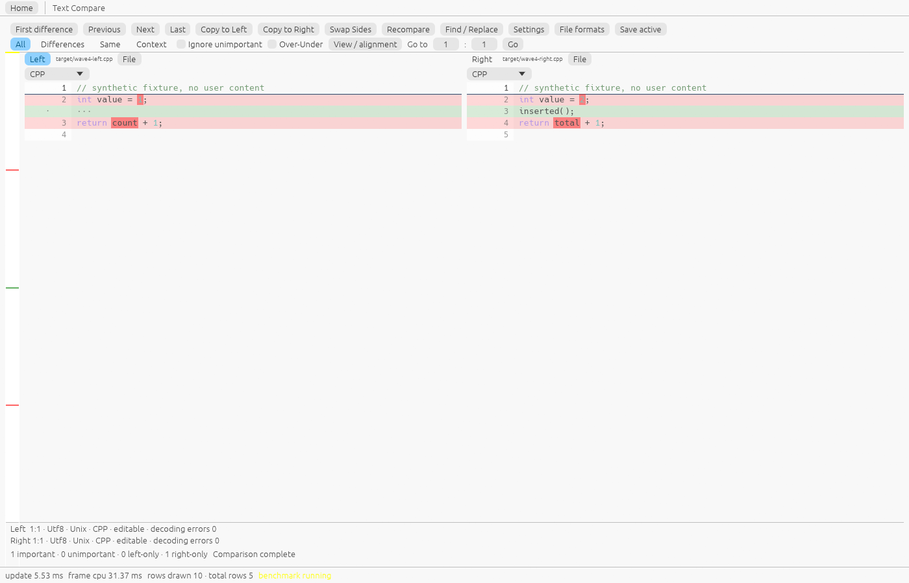

# text-compare-core — Wave 4 实施报告

## 结果：succeeded（原生 IME 候选窗另列待人工验收）

**任务组 8（8.1–8.8）、9（9.1–9.2）全部完成并勾选；OpenSpec apply 为 40/40、all_done。** 另外完成任务组 5 的 STX 用户格式名称收尾。原型 `text_view.rs` 已删除，Home/命令行现在打开真实 TextMap 双窗格控件。

| 门禁 | 最终结果 |
|---|---|
| `cargo clippy --workspace --all-targets -- -D warnings` | 退出 0，零 warning |
| `cargo test --workspace` | **122 个测试通过，0 失败**；其中 GUI 18 个 |
| `cargo build --release -p bcompare` | 退出 0 |
| 正式黄金 | **Myers 30/30（100%）、Standard 29/30（96.67%）**，既有唯一差异未增加 |
| 110 MB × 2 / 600 帧 | **update p99 1.129 ms；frame CPU p99 1.688 ms** |
| 输入后重新比较 | 真实 RawInput 补字、350 ms 防抖与 worker 应用，约 **353 ms**；测试断言 <500 ms |
| 参考帮助覆盖 | `commandstext.html` 的 **108 个 p_Command 标签，遗漏 0**；其他指定主题逐项记录 |

**验收边界已明确确认**：桌面锁定导致普通屏幕抓取 invalid handle，不能做真实 Windows 中文输入法候选窗点验。协调者在本轮 ask 中明确接受 RawInput 鼠标/键盘/IME Preedit+Commit、tessellation 与截图回归后勾选 8.4，并要求把候选窗列为环境受限待人工验收；本报告遵守该约定，不把合成提交事件说成真实输入法点验，也未尝试解锁。

## 完成清单与证据

| 任务 | 实现与验证 |
|---|---|
| 首步规范提交 | 只提交协调者的 text-importance / text-encoding 修订；没有混入文件夹 change |
| 8.1 | `text/view.rs`、`render.rs`、`gutter.rs`：真实 TextMap 派生行、对齐空隙、来源行号、三态/行内色、语法色、双轴联动、左右/上下布局；实际 GPU 截图和 110 MB 基准 |
| 8.2 | `projection.rs`：紧凑区段索引，All/Differences/Same/Context，合并上下文、点击展开；导航 First/Previous/Next/Last，首尾提示；折叠计算单测 |
| 8.3 | `nav_bar.rs`：512 桶缩略条、可视区与当前行；真实 RawInput 点击 70% 返回第 700/1000 行 |
| 8.4 | `editor.rs`：UTF-8 光标、多行选区、键盘/剪切复制粘贴、IME 预编辑与提交、只读保护、LineEdit/EditStack；`worker.rs` 350 ms 防抖 Realign2Job、取消/修订检查 |
| 8.5 | 每侧保存/另存为/保存目标、备份、关闭保护；双侧行列/编码/行尾/格式/只读/修改状态；编码重解码、BOM 策略、可撤销行尾转换、格式菜单；共享 mmap/原字节测试 |
| 8.6 | `find_panel.rs` 与控制器：正则/字面/全词/大小写/方向/差异范围、当前替换/全部替换；Copy to Left/Right、选中行复制、Swap、Reload、Recompare、拖放和 Open Clipboard |
| 8.7 | `settings_panel.rs`：Standard/Myers O(ND)/Patience/Unaligned、closeness、Never align differences、skew、五种忽略项、10 类元素、不重要文本/替换表、上下文、颜色/备份；验证后即时应用 |
| 8.8 | Home 真实接线、最近文件对、拖放两文件；删除独立原型缓冲与 mmap 依赖；原 `--bench` / `bench.*` 协议不变 |
| 9.1 | [逐命令清单](../reference-parity/text-compare.md)：Session/File/Edit/Search/View、全部 sessiontext*、viewtext、文本格式/正则；每项状态/理由，隐藏命令也核对 |
| 9.2 | 严格 Clippy、workspace 测试、黄金、release、实际原生基准全部复测；[框架决策的“正式控件复测”](../ui-framework-decision.md) 已更新 |
| [x] 组 5 收尾 | 新建用户名称不加 STX，内置副本重命名同样写字面名称；内置读→写→读原树不变，6 个 xml_roundtrip 测试通过 |

额外完成规范中的格式管理器入口：25 内置格式列表只读，复制/新建用户格式，XML 编辑、整份事务验证、导入/导出及 Matcha 设置目录持久化。它不执行格式 XML 中的外部转换程序；转换器与非文本视图明确后置。

## 正式控件性能

输入不变：`tmp/left.txt`、`tmp/right.txt` 各 **110,000,043 B / 2,119,483 来源行**。Windows x86_64 MSVC、Rust 1.99.1、eframe/egui 0.37、glow、release。不是原型或无差异着色模式。

```powershell
cargo build --release -p bcompare
.\target\release\matcha.exe tmp\left.txt tmp\right.txt --bench=600
# 同一入口也可经 cargo run --release -p bcompare -- <left> <right> --bench=600
```

| 轮次 | update mean / p99 ms | frame CPU mean / p99 ms | 加载左 / 右 ms |
|---|---:|---:|---:|
| 初测 | 0.598 / 1.151 | 1.023 / 1.744 | 135 / 136 |
| 正式复测 1 | 0.618 / 1.104 | 1.053 / 1.762 | 132 / 130 |
| 正式复测 2 | 0.626 / 1.174 | 1.074 / 1.810 | 132 / 129 |
| Tab 修正后 | 0.614 / 1.163 | 1.068 / 1.646 | 135 / 137 |
| **最终** | **0.613 / 1.129** | **1.072 / 1.688** | **134 / 133** |

真实后台比较完成后开始 30 帧预热，再测 600 帧（3 次 +3 行、1 次随机跳转）。最后一轮实际 stdout：

```text
bench.frames_measured=600
bench.wall_seconds=11.61
bench.fps_overall=54.3
bench.left_mb=110.0 bench.right_mb=110.0
bench.load_left_ms=134 bench.load_right_ms=133 bench.index_mb=101.7
bench.update_ms.mean=0.613 p50=0.524 p95=0.973 p99=1.129 max=1.354
bench.frame_cpu_ms.mean=1.072 p50=1.035 p95=1.538 p99=1.688 max=2.009
bench.rows_drawn_per_frame=78
```

所有轮次均低于 **4 / 8 ms** 门槛。`wall_seconds`/overall fps 包含前置等待真实对齐，不能当作稳态帧率。`index_mb` 现在是引擎 Line 元数据估计（行范围+逐行行尾），不是旧原型的 u32 起点表；保持的是日志格式而非旧内存布局。本轮未测 GUI 峰值私有内存，不用该数值宣称峰值内存通过。初次加载按每侧分别计时，未强制清空 OS 文件缓存。

## 手动验收清单（逐场景，实际验证方式明确列出）

下面 `[x]` 表示该场景由所列自动/运行时证据验证，**不是声称在锁定桌面上人工点过所有按钮**。真正在屏幕外可取证的是本应用 GPU framebuffer，已打开检查图像；鼠标/键盘则走实际 egui RawInput。

| text-compare-view 场景 | 结果 | 验证方式 |
|---|---|---|
| 滚动同步 | [x] | 1000 行正式控件跳到 700 行，两侧 text shape 均为 line 700；共享 x/y state、程序偏移预钳制；原生随机滚动基准 |
| 上下布局 | [x] | tessellation 回归断言左 pane bottom ≤ 右 pane top；修复曾实际发现的横向布局继承错误 |
| 默认色：行浅红、两处行内深红 | [x] | `two_inline_spans_and_unimportant_colors_reach_the_painter` 检查真实 galley 两个深红 section；GPU 图像确认浅背景/深区间 |
| 自定义重要色为橙色 | [x] | 修改 Prefs.colors.important 后下一帧 painter Rect 为橙色；插删自定义色也覆盖 |
| Differences 仅差异 | [x] | 投影测试与视图测试，来源行索引不改变；原文件行号由 TextMap 来源索引绘制 |
| Context 展开 | [x] | 折叠区段合并/展开单测与控制器展开测试，原编号保持 |
| 点击导航条 70% | [x] | RawInput PointerMoved/pressed/released，1000 行返回 700，边界 100% 钳制至 999 |
| 状态 120:8 | [x] | 1000 行正式内容，UTF-8 Caret → 状态字符串精确以 120:8 开头；各侧编码/格式/只读/修改字段同测 |
| 输入后 <0.5 s 重新比较 | [x] | 鼠标聚焦右侧、End+Text 补 c，约 353 ms 成 Same，重要计数降到 0 |
| 撤销恢复 | [x] | 同一 RawInput 测试 Ctrl+Z，原文本与重要计数恢复；IME Commit 单次撤销 |
| 只读侧拒绝 | [x] | 实际 Text/IME/Cut/编辑 API 保持文本不变且显示 read-only 错误；状态含只读 |
| 仅保存右侧 | [x] | 两侧同时脏，右侧混合行尾 UTF-8 保存仅改 TWO，无 BOM/其他字节不变，左磁盘不变且仍脏 |
| 关闭提示 | [x] | 未保存 request_home 保留视图；真实 RawInput 点击 Cancel 后仍脏且无 Home action；保存/放弃/取消路径均有真实实现 |
| 复制区块 | [x] | copy_section 已应用项进入目标历史；目标变相同并可 undo/redo，跨侧共享 mmap 保存成功；另测选中行复制 |
| 仅差异查找 TODO | [x] | 文本首行 Same 中 TODO 不命中，只命中 Changed 行；全部替换一组 undo、正则捕获单次替换 |
| 交换 | [x] | Swap 交换路径/内容/编辑器/只读/格式与手动锚点，重算后来源顺序正确；格式仍保留 |
| 拖入右侧 | [x] | 真实 DroppedFile + PointerMoved 输入，右侧换文件，左侧原字节不变；另测剪贴板打开与 Home 两文件拖放 |
| 大文件滚动基准 | [x] | 真实 Windows 原生二侧各 110 MB、最终 600 帧 p99 1.129 ms |
| Windows 中文输入法候选窗（专项） | **[ ] 环境受限，待人工验收** | 原生候选窗未验证；Preedit/Commit、未提交不修改文本、中文提交可撤销、IME 光标输出与 CJK 后备字体均有实现/自动证据 |

### GPU 截图



图中仅有本轮合成 C++ 文本。通过 `--screenshot=target/wave4-formal.bmp` 的 egui screenshot callback 取本应用 framebuffer，再无损转 PNG；不是借桌面解锁或读取其他窗口。空隙左侧不显示虚构行号，插入绿色，代码/注释语法色独立于差异背景。

### 负责人原生 IME 复测步骤

1. 在可交互 Windows 桌面，将两份合成 UTF-8 文本放到系统临时目录后打开 Matcha，不改黄金语料或原始大文件。
2. 点击右侧已有文字，切换系统中文输入法，输入拼音，检查候选窗跟随绘制光标；预编辑阶段源文本/dirty 不变化。
3. 选择候选词提交“中文”，确认只插入一次、字形可见、约半秒内重新着色；Ctrl+Z 一次撤销整个提交，Ctrl+Y 恢复。
4. 移动光标、切侧、取消候选，确认预编辑不误落到另一侧；设为 Read-only 后提交应拒绝。
5. 保存到另一临时路径检查 UTF-8/BOM/原行尾，关闭时验证保存/放弃/取消。验收结果另行追加，不能把本报告的待验格预先勾掉。

## 接口调整（下层最小修改逐项）

| 文件 | 修改 | 必要性/边界 |
|---|---|---|
| `bc-engine-text/src/rules.rs` | `AlignmentRules::use_closeness: bool`，默认 true | GUI 必须独立表达 Standard 的公开 closeness 开关，不能伪装成另一策略 |
| `bc-engine-text/src/jobs.rs` | Standard 关闭 closeness 时调用现有 unpaired Quick 骨架 | 不改 Myers SES、Smart 评分/阈值/默认规则；黄金默认行为不变 |
| `bc-engine-text/src/content.rs` | 暴露 `materialize_owned(&mut MaterializeContext)`，原 materialize_and_save 复用它 | Copy Section 使来源 mmap 跨侧共享，保存前须同 context 物化两侧当前/原始/undo/redo；另一侧 save point 不变 |
| `bc-engine-text/README.md` | 两项 API 与跨侧保存协议说明 | 不改变其他引擎或三路占位逻辑 |
| `bc-core` | **没有修改** | 直接使用现有 LineEdit/EditStack/行模型/Pattern 接口 |
| `bc-session/src/prefs.rs` | **没有修改** | 直接使用 DiffColors / BackupPrefs，由 App 持有并即时传给视图 |

GUI 不调用昂贵 align_map 物化，不向 worker 发送 Rc 编辑对象。首次/设置/编辑防抖重算通过 std 线程运行 Job::run，poll 后使用 set_alignment 拒绝过期结果；保存/卸载前 cancel+join，释放外部快照。区块复制使用现有引擎的同步 `copy_section`（返回已应用且含重比较结果的 EditItem），目标 history 记录它；未谎称该现有同步命令也已变成后台命令。

`TextMap::text_at` 是 guard，正式渲染按来源索引从便宜 ContentSnapshot 的 LineList 借用可见文本；没有构造第二张整文件 String 表。长行绘制窗口不截断文件；比较的 10,000 字符行内降级仍来自引擎。

无新增第三方依赖。移除了 bc-gui 直接 memmap2 依赖及旧 unsafe 映射；Cargo.lock 只删除 bc-gui 的该依赖项，bc-core 原有安全 mmap 不变。GUI crate 现在 forbid(unsafe_code)。

## 合并注意事项（文件夹线）

未进入另一 worktree，未读取/修改其文件，未提交/删除主工作区未跟踪的 `openspec/changes/folder-compare-sync/`。

- `app.rs` 的变动集中在：`View::TextCompare(Box<TextCompareView>)`、共享 Prefs、Home/action 分发、未保存关闭保护、正式基准与 screenshot callback。文件夹 worker 增加 `View::FolderCompare/FolderSync` 时保留这些分支；TextCompare 从原非 Box 变为 Box，解引用方法调用仍透明。
- `home.rs` 保留 `HomeAction::OpenTextCompare { left, right }`，新增最近文件和两文件拖放，去掉原型文案。文件夹入口只需扩展 HomeAction 并接入 app match，不要覆盖整份 Home。
- `text::ViewAction::CompareParentFolders { left, right }` 类型已预留；当前对应菜单禁用，因为本分支无文件夹视图。文件夹线合并时启用按钮、传入两侧路径的 parent，并处理 app 分支；不能保留空 action 消费分支后冒称命令已可用。
- 新的 `use_closeness` 字段需要合并者检查自己分支的 AlignmentRules struct literal；使用 `..Default::default()` 的调用不受影响。默认是 true，不能合并成 false 改变黄金设置。
- 保存必须物化**两侧**。不要退化为仅释放保存侧/仅清空 undo，也不要在 worker 持有快照时写原路径。
- egui 0.37 API 注意点已补到框架决策；尤其 root Ui 的 Panel、显式 top_down、clamped_offset、Id::unique 和 DroppedFile::path()。

## STX 收尾结论

- [x] 追踪 `write_bcfileformats → canonical_node` 证实原新建名称错误使用 STX=true；FormatRegistry::export_xml 复用同一写出器，所以也受影响。
- [x] 新建用户格式名称改为 false；带 source_xml 的内置副本一旦重命名，顶层 STX 清除，避免资源查找键冒充用户文字。
- [x] 未重命名的源树及其他属性保留读取标记；全部 25 内置资源读→写→读仍满足语义模型、Node 树及去格式空白后的文本相等。
- [x] 新建无 source、复制重命名、registry 用户导出重导入均加入 xml_roundtrip 回归；6/6 通过。
- [x] [ADR 001](../decisions/001-stx-write-rule.md) 已改为用户字面名规则；实测行为依据明确引用 Wave 3b，不宣称本轮重新调用参考程序。

## 提交记录

每项均有 `Co-Authored-By: pi <noreply@pi.dev>`；本报告另作最终提交，不形成自引用 hash。

| 范围 | commit |
|---|---|
| 首步 case/EOF 规范对齐 | `b1118fd0c319658b7306a852d0a47e172420072d` |
| 任务组 5 STX 收尾 | `1827bd7b7717c16c94291205c9978ab243ca8373` |
| **任务组 8 主实现** | `0a1fc5f598b7104e959bcdf73bfed414f7b5ba5a` |
| 8.x Tab 显示/编辑修正 | `4681dbeebefcc7d648697c18a8df300e5ee1f555` |
| 8.x UTF-8 光标边界与场景回归补充 | `859828c46189add76c589cd189b66ca647905e7c` |
| **任务组 9 清单、复测、截图与复选框** | `cc84eed5713f86224d1e9067ab0f26095a55dcfb` |

## 最终命令输出（最后 10 行；不足则全部）

### cargo clippy --workspace --all-targets -- -D warnings

退出 0、零 warning，最后为增量检查：

```text
    Checking bc-gui v0.1.0 (D:\Github\Matcha\crates\bc-gui)
    Finished `dev` profile [unoptimized + debuginfo] target(s) in 0.59s
```

### cargo test --workspace

退出 0，122 passed / 0 failed，两个正式黄金入口实际执行，未走缺失 oracle 分支。尾部是没有 doctest 的 crate：

```text
running 0 tests

test result: ok. 0 passed; 0 failed; 0 ignored; 0 measured; 0 filtered out; finished in 0.00s

   Doc-tests bcomp

running 0 tests

test result: ok. 0 passed; 0 failed; 0 ignored; 0 measured; 0 filtered out; finished in 0.00s

```

### cargo build --release -p bcompare

```text
    Finished `release` profile [optimized + debuginfo] target(s) in 0.17s
```

### 黄金明确输出

```text
golden.myers=30/30 golden.standard=29/30 known_diffs=1
```

唯一差异仍为 `012-unrelated-replacement`：Standard 对完全不相似替换保持项目“不强配”规则；未修改期望/归一化来掩盖差异。完整本地日志为 `target/wave4-{clippy,test,build,golden,gui-tests}.log` 与 `target/wave4-bench-final4.log`，未将大构建日志入库。

## 剩余事项与安全边界

本轮批准范围内无实现阻塞；仅原生 Windows 中文输入法候选窗按上文授权约定待负责人在可交互桌面复测。原生文件对话框、Word Wrap、书签、独立详情、报告、会话/文件夹联动等按 [逐项清单](../reference-parity/text-compare.md) 后置，不伪装成已实现。后续是否归档 change 由协调者决定，本 worker 未归档。

未访问 `D:\Github\ObsidianVault`，未访问其他 worker 工作区，未读取/复制授权或密钥文件，未写参考安装目录，也未启动参考工具。CHM 只解包指定帮助主题到系统临时目录；本轮无需占用 reference-tool 执行锁。基准输入未修改，生成截图使用的额外输入只有 target 下的自造文本。
